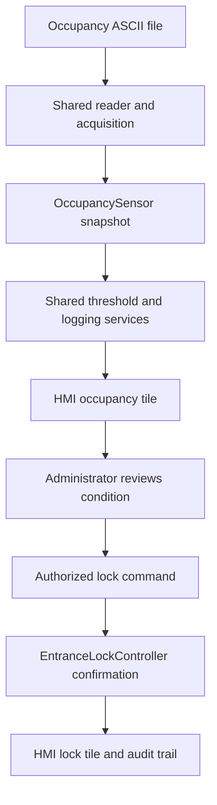

# Olawale's device and HMI design draft

**Project:** SmartShop SCADA/HMI  
**Owner:** Olawale Quadri  
**Basis:** Revised SmartShop SRS, 10 November 2026  
**Status:** Draft for team review before implementation

This design covers the `OccupancySensor`, `EntranceLockController`, and the shared HMI dashboard layout assigned to Olawale in Planner. The current repository's README describes older kiosk and automatic lockout behavior. The revised SRS excludes shopping workflows and specifies administrator-issued actuator commands; the team should reconcile the README before implementation.

**SRS traceability:** REQ-TEL-001 through REQ-TEL-003, REQ-STS-001, REQ-CTL-001, REQ-CTL-007, REQ-AUTH-001, REQ-LOG-001/002, REQ-INT-001, REQ-USA-001/002; stories US-TEL-01/02, US-STS-01, US-CTL-01, US-AUD-01.

## 1. Boundaries and ownership

| Component | Responsibility | Shared dependency |
| --- | --- | --- |
| `OccupancySensor` | Validate and expose a nonnegative people count from its simulated source | Common looped ASCII reader, acquisition scheduler, telemetry contract, threshold classifier |
| `EntranceLockController` | Expose `Locked` or `Unlocked` feedback and apply validated supervisory commands | Common command service, authorization, audit repository, simulator |
| HMI dashboard view | Present twelve device tiles and controls without hiding quality or command outcomes | Snapshot endpoint, command endpoint, authentication |

The device classes do not implement a second file reader, threshold engine, authentication layer, or SQLite repository. Those are shared services owned elsewhere in the team design.

## 2. Occupancy sensor contract

- Stable ID: `OccupancySensor`; display name: `Store Occupancy`; unit: `people` (or the team's agreed `count` unit).
- A valid reading is a finite, whole, nonnegative number. The common reader supplies the sequence number and typed reading from this sensor's own looped ASCII file once per second. The acquisition service adds the UTC acquisition time.
- The sensor publishes the shared `TelemetryPayload`: device ID, sequence, count, unit, quality, condition, acquisition time, and last valid time when retaining an older reading.
- The shared threshold engine uses the **high** direction. For configured warning `W` and critical `C`, with `W < C`: Normal below `W`, Warning from `W` up to but excluding `C`, Critical at or above `C`.
- Missing or malformed input makes quality `Unavailable` immediately. More than three seconds without a successful sample makes it `Stale`. The previous count may be displayed only as **last known**; condition becomes `Unknown`. A valid sample restores `Available` and triggers reclassification.
- Persist valid samples and transitions through the shared logging service. Repeated unchanged Warning/Critical states should not flood the event log.

## 3. Entrance lock controller contract

- Stable ID: `EntranceLockController`; display name: `Entrance Lock`; accepted settings: `Locked` and `Unlocked`.
- Its own looped ASCII file supplies baseline lock feedback while no manual override is active. The HMI displays the state, quality, UTC time, and `NotApplicable` condition.
- Only an authenticated administrator can request a change. The server validates the requested setting and derives the actor from the session before sending a `ControlCommand` to the common command service.
- During dispatch, the HMI shows `Pending`. A confirmed success updates the state and establishes a manual override. Later baseline file samples must not undo that confirmed state. Simulation restart clears the override.
- Rejection or failure preserves the previous confirmed state. If confirmation takes more than two seconds, report `TimedOut` with `Unavailable` quality and label the previous state **last known**. Never display a requested state as confirmed before success.
- The shared audit service records every attempt, including denied, rejected, failed, timed-out, and successful outcomes, using `CommandId`, actor, device, requested setting, previous state, UTC time, outcome, and confirmed state when known.
- The revised SRS does not require occupancy to lock the entrance automatically. A Critical occupancy reading is visible to the administrator, who may issue a manual lock command. Confirm this scope choice with the group because the repository README still says "auto-lockout."

## 4. Dashboard layout

The browser HMI has a header with the signed-in administrator, a persistent logging-fault notice when needed, and a summary of Normal, Warning, Critical, and Unknown sensors. The main area shows **seven sensor tiles and five actuator tiles**. Each tile always displays its name, current or last known value/state, quality text, condition text where applicable, and UTC timestamp. Colour reinforces the labels but never replaces them.

The occupancy tile shows count in people and high-threshold condition. The entrance lock tile shows Locked/Unlocked plus a control available only to an authorized administrator. Its command area distinguishes Pending, Succeeded, Failed, Rejected, and TimedOut. The administrator can open event and audit history and filter by device and UTC time range.

The view reads snapshots from the server. It does not read simulation files or SQLite directly, calculate thresholds independently, or change lock state locally before command confirmation.

## 5. Interaction paths

The diagram shows a possible operator response. It does **not** imply automatic lock commands when occupancy rises.

## 6. Acceptance scenarios for Olawale's work

1. Counts just below, exactly at, and above both configured high thresholds show the correct condition.
2. A valid occupancy file loops at end of file and continues publishing a new sample each second.
3. Missing, malformed, or stalled occupancy data becomes Unavailable or Stale as specified, labels the retained value last known, and recovers on a valid sample without stopping the other eleven devices.
4. The entrance lock displays baseline file feedback before a command. A confirmed `Locked` or `Unlocked` command survives subsequent differing file samples until restart.
5. Invalid, denied, failed, and timed-out lock commands never display the requested state as confirmed; the command outcome and logging fault (if any) remain visible.
6. The dashboard renders all twelve device tiles with readable text labels, units where applicable, quality, condition, and UTC timestamps. An authorized lock action and its audit result are discoverable during usability testing.

## 7. Integration decisions to confirm before code

- The feature branches currently use different device IDs and telemetry shapes. The revised SRS calls for a stable `DeviceId`, `Sequence`, `Quality`, `Condition`, `AcquiredAtUtc`, and `LastValidAtUtc`. Agree the final shared C# types before implementing these classes.
- Agree the per-device ASCII record format and where the one-second scheduler/reader lives. A repository branch currently documents one combined file with five-second steps, while the revised SRS calls for one file per device and one-second reads.
- Agree the exact MVC project location and snapshot/command endpoint signatures. `main` currently has a .NET class-library scaffold rather than a web application.
- Confirm task IDs and the required branch names before opening pull requests. Do not push directly to `main`.
